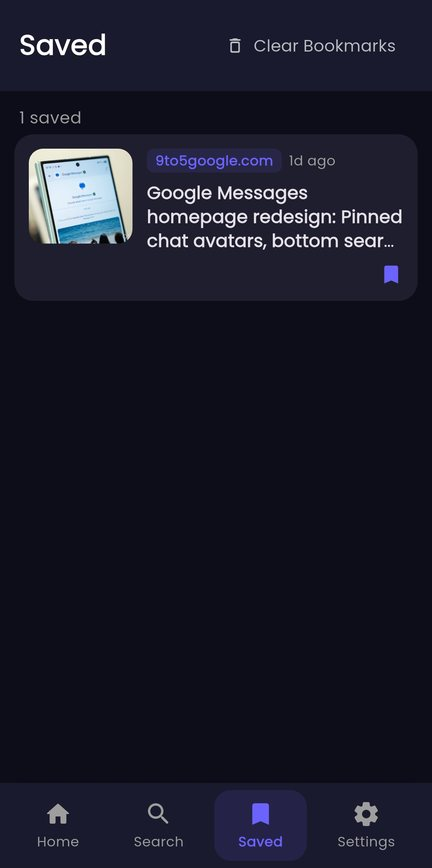
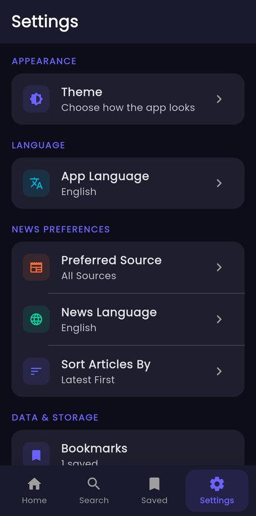

# 📰 News App

**A Flutter news reader for Android: top headlines by category, search, bookmarks you can read later, and an interface in English, Urdu or Arabic with light and dark themes.**

[](https://github.com/Umair-Habibx123/news-app/actions/workflows/ci.yml)
[](https://github.com/Umair-Habibx123/news-app/releases/latest)
[](https://flutter.dev)
[](LICENSE)

**[⬇️ Download the latest APK](https://github.com/Umair-Habibx123/news-app/releases/latest)** · Android 7.0+ · enable "Install unknown apps" for your browser or file manager first.

News comes from [NewsAPI.org](https://newsapi.org/).

| Home | Article | Saved | Settings |
| :---: | :---: | :---: | :---: |
|  |  |  |  |

## Features

- **Headlines:** trending stories in a horizontal carousel, then the latest news in a scrolling list with pull-to-refresh and infinite scroll
- **Categories:** general, business, entertainment, health, science, sports and technology
- **Search** articles by keyword
- **Bookmarks:** save articles on the device (SQLite) and read them later
- **Article view:** image, source and date, open the full story in the browser, or share it
- **Settings:**
  - App language: English, اردو or العربية, with right-to-left layout and a matching font
  - News preferences: content language, preferred source, and sort order (latest, most relevant, most popular)
  - Theme: light, dark or system
- **Offline aware:** detects lost connectivity and shows a retry screen

## Install

1. Open the **[latest release](https://github.com/Umair-Habibx123/news-app/releases/latest)** and download `news_app-vX.Y.Z.apk`.
2. Optionally check the download against the `.sha256` file next to it.
3. Open the APK on your phone and allow installing from that app if Android asks.

Releases from v1.2.0 on are signed with the same key, so new versions install over old ones. v1.0 and v1.1 used the old app ID, so uninstall them first.

## Build it yourself

You need **Flutter 3.47+** and the Android SDK.

```bash
git clone https://github.com/Umair-Habibx123/news-app.git
cd news-app
echo "API_KEY_UMAIR=your_newsapi_key" > .env   # free key from https://newsapi.org/register
flutter pub get
flutter run                                   # on a connected phone or emulator
flutter build apk --release                   # APK in build/app/outputs/flutter-apk/
```

Without `android/key.properties`, release builds are signed with the debug key. That's fine for testing on your own phone.

| Command | What it does |
|---|---|
| `flutter test` | Runs the tests: translations, right-to-left detection, and the offline screen |
| `flutter analyze` | Static analysis |

> **About the API key:** `.env` is ignored by Git, but it ships inside the APK, so treat a NewsAPI key in any app build as public. NewsAPI's free plan is meant for development; a widely distributed app needs a paid plan or its own backend proxy.

## How it's built

| Part | What it uses |
|---|---|
| State | `provider` (ChangeNotifier per feature) |
| Networking | `http` to NewsAPI `/v2/top-headlines` and `/v2/everything` |
| Storage | `sqflite` for bookmarks, `shared_preferences` for settings |
| UI | Material 3, Google Fonts (Poppins, Noto Naskh Arabic), `page_transition`, `flutter_spinkit` |
| Device | `connectivity_plus`, `url_launcher`, `share_plus` |
| Localization | A small built-in string table (`lib/l10n/`) for English, Urdu and Arabic |

```
lib/
├── main.dart              app setup, providers, themes
├── l10n/                  English, Urdu and Arabic strings
├── screens/               home, category, search, bookmarks, detail, settings, splash
└── services/              NewsAPI client, bookmarks (SQLite), search, theme, language, connectivity
```

## Releasing (for maintainers)

Pushing a version tag builds a signed APK in GitHub Actions and publishes it as a release:

```bash
git tag v1.2.0
git push origin v1.2.0
```

The workflow needs these repository secrets: `NEWS_API_KEY`, `ANDROID_KEYSTORE_BASE64`, `ANDROID_KEYSTORE_PASSWORD`, `ANDROID_KEY_ALIAS` and `ANDROID_KEY_PASSWORD`. See [`.github/workflows/release.yml`](.github/workflows/release.yml).

## License

[MIT](LICENSE) © 2025 [Umair Habib](https://github.com/Umair-Habibx123)
